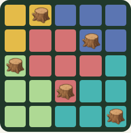
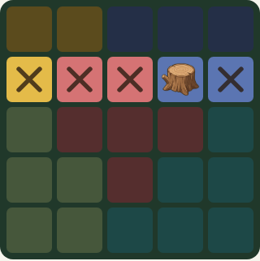
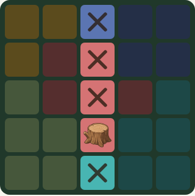
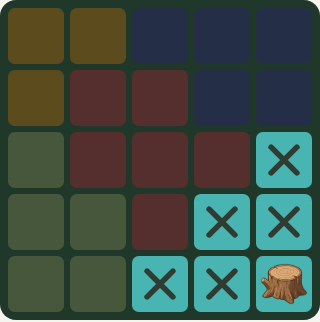
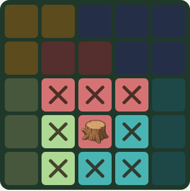
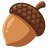
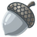
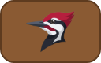
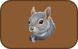

# Stumped

Stumped is a mobile-first, offline puzzle game for the Stump family. It is a
personal remake of Meowdoku that keeps the region-based placement puzzle and
quick marking gestures while removing ads.

Each puzzle has an N × N grid divided into N connected, colored regions. Place
one stump in every row, column, and region, with no two stumps touching—even
diagonally. Boards range from 5 × 5 to 10 × 10.

The game is designed for phones and tablets, runs entirely on the device, and
needs no account or internet connection. Its woodland theme turns the original
cats into stumps, color regions into patches of forest floor, and hints into
woodpeckers, owls, and squirrels.

See [Stumped Product Requirements](docs/Stumped%20Product%20Requirements.md)
for the full design and game rules.

## How to play

<p align="center"></p>

Every forest hides one stump for each row. Find them all by logic, before you
run out of acorns.

### The rules

| | |
| :---: | --- |
|  | **One stump** in every row. |
|  | **One stump** in every column. |
|  | **One stump** in every color patch. |
|  | **Stumps never touch,** not even at the corners. |

### Controls

| | |
| :---: | --- |
|  | **Tap** a square to put an X on it, as a note that no stump is there. Tap again to clear it. |
|  | **Drag** across squares to mark them all. Start on an X to erase instead. |
|  | **Double tap** a square to reveal its stump. |
|  | A wrong guess leaves a red X and costs an acorn . You start with three, or one in silver acorn mode . |
|  | Takes back your last tap or drag. Reveals, hints, and lost acorns stay. |
|  | Opens a pencil layer to test an idea. Double tap for a pencil stump, which is never checked and costs nothing. **Keep** turns your pencil X's into real ones, and **Discard** throws them away. |
|  | Pencil stumps are small, and pencil X's sit in the corner. A pencil stump that breaks a rule gets a red ring. |

### Hints

Each hint works once per puzzle, but not while What if? is on. A solve with a
hint doesn't earn the clean solve ★.

| | |
| :---: | --- |
|  | **Woodpecker** reveals a stump for you, in the patch with the fewest open squares. |
|  | **Owl** explains the next step you can work out, and makes that mark when you close it. It is also the only way to learn that one of your X's covers a stump. |
|  | **Squirrel** puts X's on three random squares that have no stump. |

In the Puerto Vallarta theme, stumps become skulls, acorns become margaritas,
the woodpecker a parrot, and the squirrel a gecko. The rules are the same.

The same guide is in the game: tap **Help** on the home screen, or **?** while
playing.

## Playing

[Play it](https://stumpedgame.app/), or run it locally:

```
pnpm install
pnpm run dev
```

Detailed puzzle-solving data collection is disabled by default. To enable the
per-stump history, local solve log, and **Copy solve data** button in Settings,
set `VITE_COLLECT_SOLVE_DATA=true` when building:

```sh
VITE_COLLECT_SOLVE_DATA=true pnpm run build
```

The same variable works with `pnpm run dev` and Vite's `.env` files. Only the
literal value `true` enables collection; unset, `false`, and other values disable
it. Changing the value requires a new build (or restarting the dev server).
Disabled builds leave existing solve logs untouched. Normal progress, best times,
and lifetime stats are saved regardless of this flag.

## Offline

On the published site, the first visit saves a copy of the game in the
browser: the page, scripts, images, and puzzle generator. After that, opening
the game, following a seed-code link, and dealing another puzzle work with no
connection. Progress stays on the device, separate from that copy.

A later visit while online replaces the copy when the build has changed. The
local dev server does not install it. The other versions hosted beside the
main game keep their own copies, and this one does not answer their pages.

## Release notes

See [CHANGELOG.md](CHANGELOG.md)

## Agent bake-off

Four agents independently built the game from clean copies of the same commit,
with dependencies installed and the project assets, tests, screenshot utility,
and Phaser 4 guidance available. Each received the prompt:

> Read [@docs/Stumped Product Requirements.md](docs/Stumped%20Product%20Requirements.md)
> and implement the game using Phaser 4. The core engine has already been
> implemented (see [@src/engine/README.md](src/engine/README.md)). Verify your
> work using tests and the screenshot utility, which you should enhance as
> needed.

Each agent was run at high or extra high effort level.

| Agent | Branch | Play | Tokens | Cost |
| --- | --- | --- | ---: | ---: |
| Gemini 3.8 Flash | [gemini](https://github.com/weevilgenius/stumped-game/tree/gemini) | [Play](https://weevilgenius.github.io/stumped-game/gemini/) | 27.8 million | $3.24 |
| Grok 4.7 | [grok](https://github.com/weevilgenius/stumped-game/tree/grok) | [Play](https://weevilgenius.github.io/stumped-game/grok/) | 16.2 million | $6.00 |
| Fable 5.1 | [fable](https://github.com/weevilgenius/stumped-game/tree/fable) | [Play](https://weevilgenius.github.io/stumped-game/fable/) | 21.4 million | $26.40 |
| GPT 6 Astra | [astra](https://github.com/weevilgenius/stumped-game/tree/astra) | [Play](https://weevilgenius.github.io/stumped-game/astra/) | 8.3 million | $14.99 |

### Notes

All of the agents had to create their own "X" sprites with mediochre results. I used
screenshots from the original game while crafting the PRD and to extract useful region
colors, but I did not give the agents any screenshots to work with. Giving each agent
a screenshot utility to inspect its work was critical to getting good results without
extensive prompting.

My personal summary:

Gemini's game worked but was less polished and more error prone than the others. I
was worried about its ability to complete the game in one shot, which is why I ended
up building the core engine separately and providing it to the agents. Grok's result
was servicable but not stand out. Fable's implementation had the best animations and
game play interaction. Astra leaned hard into the theme and built a very elaborate
(and amusing) home screen.

### Running the agent versions

Clone the repository. Then run:

```
git switch <agent_branch>
pnpm install
pnpm run dev
```
